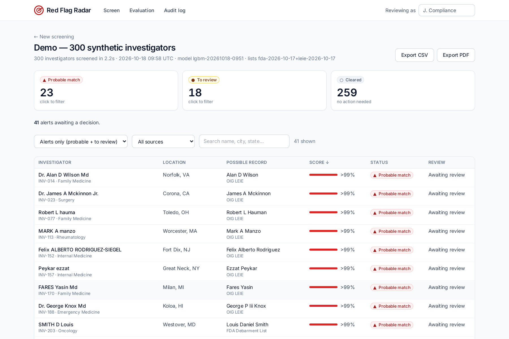

# Red Flag Radar

**Screen clinical-trial investigators against public sanction lists in seconds, with a calibrated
confidence score, plain-language reasons and a link to the official record for every match.**

Built for the Regeneron *Reinvent Clinical Trials* track at HackHarvard 2026 ("Red Flag Radar" brief).

**Live demo: https://radar.rahandrisoa.com** (click "Use the demo set")



## The problem

Before a sponsor works with a trial site, someone must check that the investigator has not been
excluded by the HHS Office of Inspector General or debarred by the FDA. The lists are public but
scattered, and the check is usually done by hand, name by name. The hard part is identity:
there are many "J. Smith"s. A missed match puts the trial at risk; a false match wrongs an innocent doctor.

## What it does

1. **Upload** a CSV of investigators (name, city, state, specialty, NPI if known), or use the demo set.
2. **Match**: each name is compared with 80,591 OIG LEIE individuals and 152 FDA debarment records.
   A machine-learning model estimates the probability that the investigator and the record are the same person.
3. **Triage**: every investigator lands in one of three zones: **Probable match**, **To review**, **Cleared**.
4. **Explain**: each alert shows the two records side by side, the top reasons behind the score (SHAP),
   the sanction type and date, and a link to the official source.
5. **Decide**: a person confirms or dismisses the alert, with a mandatory comment. The tool never decides.
6. **Audit**: every decision is logged with reviewer, time, model version and list version; export to CSV or PDF.

## Results

Four labeled test sets of 300 synthetic investigators each (1,200 in all: 120 real sanctioned people with
altered names, 160 invented innocent namesakes, 920 others), never used in training:

| Method | Sanctioned found (recall) | "Probable" that are right (precision) | Innocent namesakes marked "probable" |
|---|---|---|---|
| **Red Flag Radar (LightGBM, calibrated)** | **97.5%** (117/120) | **97.9%** (95/97) | **2 of 160** |
| Exact-name check | 28.3% (34/120) | 14.8% (34/230) | 103 of 160 |

Screening 300 investigators takes about **2 s**. In the main set, the namesake marked "probable" shares the
sanctioned person's full name, state and specialty, and only the sanction record has an NPI: no model can
separate them without it, so the app asks the reviewer to request the NPI. The two sanctioned people it
missed had moved to another state, had a typo in their name and no NPI.

Per-set figures, the logistic-regression reference and the precision-recall curve are in
`reports/eval.json`, `reports/pr_curve.png` and on the **Evaluation** page of the app.

The test sets mix real sanctioned people whose names were altered the way site lists mangle them
(typos, initials, swapped first/last names, nicknames, compound surnames, titles) with invented doctors who
share a sanctioned person's name.

## How the matching works

- **Normalization**: case, accents, titles (Dr, MD), suffixes (Jr, III), name order, specialty vocabulary.
- **Blocking**: candidate pairs share a Double Metaphone surname code or a name prefix key
  (robust to swapped names and typos).
- **12 pair features**: Jaro-Winkler on last and first names, nickname table, first initial, swapped names,
  phonetic agreement, NPI equal / different / missing, state, city, specialty, middle initial, and
  **surname rarity** from the 2010 US Census (a shared "Smith" means less than a shared rare name).
- **Model**: LightGBM with monotone constraints (agreeing evidence can only raise the score), then
  **isotonic calibration** so a score of 0.9 means roughly 9 in 10 such pairs are the same person.
  Logistic regression is kept as a reference.
- **Training data**: ~200k labeled pairs generated from a *separate* pool of sanction records with a
  different random seed. The 300-investigator test set is never seen in training.
- **Thresholds**: "probable" at 0.90; "to review" at the best F2 score on held-out training pairs (0.16).

## Data sources

| Source | Content | Used as |
|---|---|---|
| [OIG LEIE](https://oig.hhs.gov/exclusions/exclusions_list.asp) (`UPDATED.csv`) | Excluded individuals and entities, NPI when known | Sanctions |
| [FDA Debarment List](https://www.fda.gov/inspections-compliance-enforcement-and-criminal-investigations/compliance-actions-and-activities/fda-debarment-list-drug-product-applications) | Debarred individuals, Federal Register links | Sanctions |
| [US Census 2010 surnames](https://www.census.gov/topics/population/genealogy/data/2010_surnames.html) | Surname frequency | Rarity feature |

Dated snapshots are committed under `data/raw/` so results are reproducible. Every record keeps its
source, URL, retrieval date and list version. Record ids are content hashes, stable across list updates.

## Run it

**One command** (Docker):

```bash
git clone https://github.com/<you>/red-flag-radar && cd red-flag-radar
docker compose up -d --build      # then open http://localhost
```

**Developer setup** (Python 3.11, Node 20):

```bash
make setup              # venv + Python dependencies
make all                # import lists, build test set, train, evaluate, run tests
make api                # API on :8000
cd frontend && npm install && npm run dev   # UI on :5173
```

Behind Cloudflare with SSL mode "Full", also serve HTTPS on 443 (put an origin certificate in `deploy/certs/`):

```bash
docker compose -f docker-compose.yml -f docker-compose.tls.yml up -d
```

`make data` downloads fresh lists (falls back to the latest snapshot if offline; set `RADAR_OFFLINE=1`
to always use snapshots).

## Project layout

```
pipeline/   sources.py (download + schema), normalize.py, features.py (blocking + features),
            synth.py (synthetic investigators), train.py, evaluate.py, matcher.py (scoring + SHAP)
backend/    FastAPI app: screenings, alerts, decisions, audit log, CSV/PDF export
frontend/   React + Vite + Tailwind + Recharts: Import, Results, Alert, Evaluation, Audit
tests/      pytest: normalization, features, metrics, end-to-end API flow
```

## Responsible use and limits

- A match is a **lead to verify, never a verdict**. Decisions require a named reviewer and a comment.
- The investigator side of the demo is **synthetic**; sanction records are real public data.
- FDA records carry names only, and only ~10% of LEIE records list an NPI, so many decisions rest on
  name, place and specialty. A true namesake with the same middle initial, state and specialty cannot be
  told apart without an NPI; the app then suggests asking the site for it.
- Decision support only, no direct patient-safety impact: low risk under FDA's Computer Software
  Assurance approach. Not validated for GxP use. Traceability follows ICH E6(R3) principles
  (who, what, when, on which data). Production use would add single sign-on and scheduled re-screening.

## License

MIT
